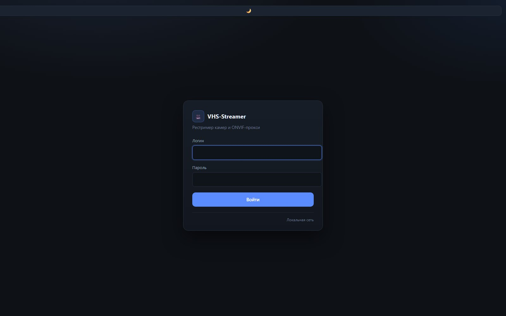
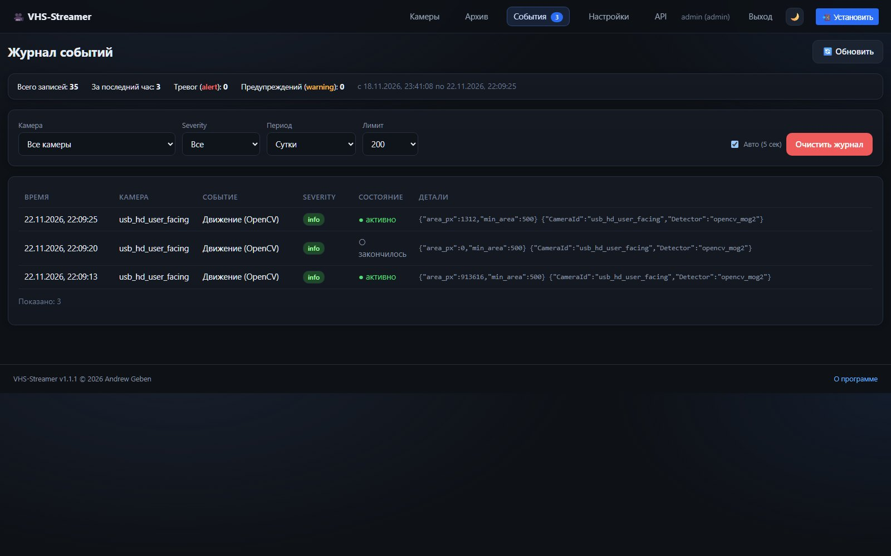
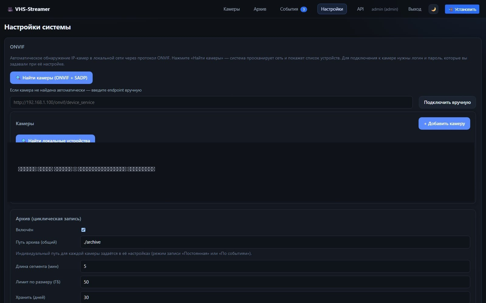
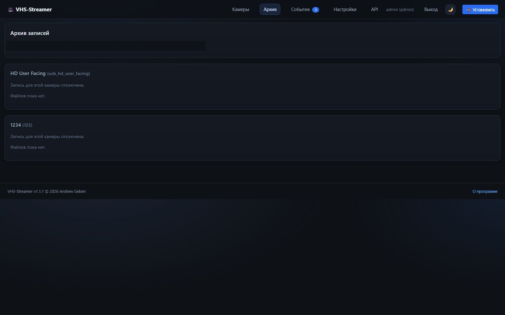
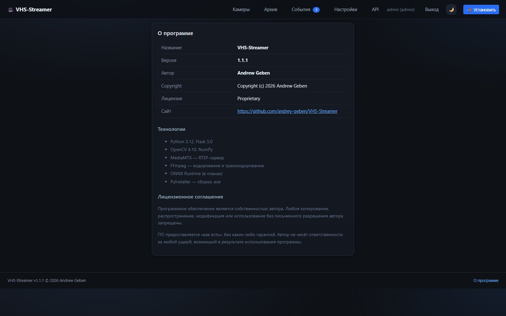

# VHS-Streamer

[](https://github.com/andrey-geben/VHS-Streamer/actions/workflows/ci.yml)
[](LICENSE)

Сервер видеонаблюдения с RTSP-раздачей через MediaMTX, транскодированием,
DVR-архивом с навигацией по нему, ONVIF-прокси для NVR, PTZ-управлением,
motion detection на OpenCV, обнаружением локальных устройств и камер
(ONVIF + SADP) и системным мониторингом.

Работает как самостоятельный продукт на **ARM (NVIDIA Jetson TX2 NX,
Axiomtek AIE100-T2NX-1L1P)** и на обычном ПК под Windows/Linux, а также
как источник потоков для **VHS-Viewer** и **VHS-Security**.

Проект рассчитан на корпоративную эксплуатацию: несколько сетевых
интерфейсов, изоляция сегментов, передача одного и того же потока в разные
сети без дополнительной нагрузки на камеру. Интегрируется с **Интеллект-икс**,
**Интеллект** и другими NVR через ONVIF.


## Скриншоты

| Вход | Журнал событий |
|---|---|
|  |  |

| Настройки камер (демо, данные скрыты) | Архив (демо, путь скрыт) |
|---|---|
|  |  |

| О программе |
|---|
|  |

---

## Возможности

### Захват
- **IP-камеры** (RTSP/HTTP) — прямое подключение через OpenCV.
- **Аналоговые камеры** — USB, карты захвата, dshow (Windows) / V4L2 (Linux).
- **Loopback через MediaMTX** — все камеры читаются один раз, дальше
  раздаются множеству клиентов без перегрузки.
- **ONVIF** — автообнаружение камер в сети, получение RTSP-адресов
  через профили, определение модели и производителя.
- **Обнаружение локальных устройств** — кнопка «Найти локальные
  устройства» в `/settings`: перечисляет USB-камеры и карты захвата
  (DirectShow на Windows, V4L2 на Linux). Позволяет выбрать устройство
  из списка и предзаполнить форму новой камеры.
- **SADP (Hikvision)** — параллельно с ONVIF WS-Discovery. Кнопка
  «Найти камеры (ONVIF + SADP)» сканирует оба протокола одновременно,
  объединяет результаты по IP и показывает MAC, серийный номер, модель
  и порты. Работает для Hikvision с выключенным ONVIF.
- **Дополнительные методы поиска** — SSDP/UPnP, Dahua/Amcrest broadcast
  и ISAPI-проба Hikvision. Включаются галочками рядом с кнопкой поиска;
  результаты объединяются по IP.

### Раздача RTSP
- **До 3 потоков** с одной камеры (лимит настраивается).
- Работает во всех плеерах и NVR (VLC, Интеллект-икс, ffplay).
- Готовые ссылки в UI для каждого сетевого интерфейса.
- **WebRTC-превью** в браузере — полное качество, минимальная задержка.
- **Авторизация дублей** — белый список IP клиентов и пароль на чтение
  для каждого потока отдельно. Управление через UI (кнопка ✎).
  Пароль хранится хешем (`sha256:<base64>`) в `authInternalUsers`
  и синхронизируется в `mediamtx.yml` при каждом CRUD.
- **Редактирование потока** — смена RTSP-пути, whitelist IP и пароля
  без пересоздания камеры. При смене path все текущие читатели
  отключаются (у MediaMTX нет rename).
- **Автогенерация пароля** при создании нового потока. При первом
  сохранении пароль показывается **один раз** в модалке «Поток создан»
  вместе с готовыми RTSP-URL вида `rtsp://vhs_<id>:<pass>@host:8554/<path>`.

### Транскодирование
- **Автоопределение рабочих H264-кодеков**: `libx264`, `h264_qsv`,
  `h264_nvenc`, `h264_amf`. Проверяется реальным запуском FFmpeg при старте.
- **GPU-ускорение** — Intel Quick Sync, NVIDIA NVENC, AMD AMF.
- **Пресеты** в UI: «Мобильный (эконом)», «Мобильный», «Веб / удалённый»,
  «Полное качество».
- **Оценка нагрузки CPU** прямо в форме создания потока.

### PTZ-управление
- **Обнаружение PTZ** через ONVIF (`GetCapabilities`, `GetConfigurations`).
- **Панель на карточке камеры** — компактная, по клику 🎮.
- **Панель в полноэкранном режиме** — крупные кнопки.
- **Расширенная панель в настройках** — стрелки 3×3, зум, пресеты, домой.
- **Управление**: движение (нажатие/удержание), зум, пресеты (создать,
  перейти, удалить), возврат в исходное положение.
- **Инверсия PTZ** — переключение направления pan/tilt/zoom для камер,
  установленных нестандартно. Настройка хранится в конфиге камеры и
  действует одинаково во всех Viewer и Security.

### Связка VHS

Streamer — источник камер, потоков и PTZ для остальных модулей.

```text
GET  /api/integration/info       — версия, endpoints, схема авторизации
GET  /api/integration/streams    — потоки с актуальными WebRTC-URL
GET  /api/ptz/capabilities       — PTZ-возможности и инверсия осей
POST /api/cameras/<id>/ptz/*     — движение, зум, пресеты, стоп
```

Внутренняя авторизация: `X-VHS-Key` (основной), совместимые
`X-API-Token` и `X-VHS-Service`. Ключ задаётся в `config.yaml`:

```yaml
security:
  api_token: <ключ интеграции>
```

Подробная схема подключения — в [`docs/VHS-INTEGRATION.md`](docs/VHS-INTEGRATION.md).

### Motion detection (OpenCV)
- **Независимо от ONVIF** — работает для любой камеры (IP, USB, аналог),
  потому что кадры проходят через `Camera._run()`.
- **Настройка через UI** — чекбокс «Motion detection (OpenCV)» и слайдер
  чувствительности (`min_area` 100–5000 px) в модалке камеры.
- **Дедупликация** — повторные события не засоряют журнал, но продлевают
  активную запись (`EventRecorder`).
- **Нагрузка ~5–15% одного ядра** на камеру (при 25 fps, downscale 320px,
  frame_skip=2). Работает параллельно с ONVIF Events — дубликаты
  подавляются дедупликацией.

### Аудио (для IP-камер)
- **Проверка наличия звука** через FFprobe — кнопка «Проверить звук» в UI.
- **Включение/выключение** захвата — галочка в настройках камеры.
- **Запись в архив** — звук попадает в MP4 автоматически. Формат
  конвертируется в AAC (MP4 не поддерживает `pcm_alaw` от IP-камер).
- **Passthrough без перекодирования** для видео — минимальная нагрузка.

### Архив (DVR)
- **Три режима записи** для каждой камеры:
  - `off` — запись отключена;
  - `always` — постоянная DVR-запись сегментами;
  - `events` — только по событиям (движение, тревожный вход, вскрытие).
- **Настройка длительности** записи по событию (от 5 до 3600 секунд),
  автоматическое продление, если событие повторилось.
- **Выбор типов событий** — движение / тревожный вход / вскрытие /
  проблемы с носителем / потеря сети.
- Автоочистка по размеру и по возрасту.
- **Без перекодирования видео** — `-c:v copy`, качество как с камеры.
- Индивидуальный путь архива на камеру (внешний диск, NAS).
- Запись разрешена только на **внешний носитель**. Путь внутри каталога
  программы или на системном диске отклоняется.
- Если внешний носитель не подключён, запись не активна; в настройках
  показывается причина и свободное место после подключения.
- Структура `archive/<camera_id>/<YYYY-MM-DD>/<HH-MM-SS>.mp4`.

### Навигация по архиву
- **Кнопка 📼** на карточке камеры → модалка «Архив».
- **Canvas timeline** — зелёные полоски (сегменты записи) и цветные
  штрихи (события по типу) на шкале 0:00–24:00.
- **Video player** с кнопками ⏮ / ▶ Всё / ⏭ и чекбоксом «авто-переход»
  между сегментами. По окончании сегмента автоматически играет следующий.
- **Playhead** (белая полоса на canvas) движется синхронно с видео.
- **Chips событий** справа от плеера — вертикальный список с временем,
  цветом по типу события и hover-подсказкой. При большом числе событий
  прокручивается внутри колонки, не растягивая модалку. Клик по chip →
  переход к моменту события в покрывающем сегменте.
- **Легенда типов событий** над chips — показывает только те группы,
  которые есть в текущей дате.
- **Дата-навигация**: ◀ / ▶ / Сегодня, date picker.
- **При смене даты** — плеер останавливается и сбрасывается, canvas
  перерисовывается.

### ONVIF-прокси для NVR (Интеллект-икс)
- **Device Service** — модель, производитель, версия, capabilities.
- **Media Service** — профили камер, RTSP-адреса, конфигурации кодирования.
- **Events Service** — PullPoint-подписка на события от камер.
- **WS-Security авторизация** (PasswordText + PasswordDigest).
- **Публичные методы** — `GetSystemDateAndTime`, `GetWsdlUrl` без авторизации
  (как требует ONVIF-стандарт).

### Журнал событий
- **Страница `/events`** — таблица с фильтрами по камере, severity, периоду.
- **Автообновление** каждые 5 секунд.
- **Счётчик новых событий** в шапке меню.
- **Хранение** в SQLite с дедупликацией (одно событие = одна запись).

### Системный мониторинг
- **4 панели на главной** — CPU, RAM, диски, GPU.
- **CPU** — загрузка %, число ядер, текущая частота.
- **RAM** — used / total в ГБ и %.
- **Диски** — все физические тома: метка, used/total, % заполнения.
- **GPU** — имя адаптера, VRAM, загрузка %. Работает для Intel iGPU,
  NVIDIA и AMD через WMI `Win32_VideoController` + `GPUEngine`.
  При нескольких GPU — показывает оба (NVIDIA и Intel, например).
- **Polling каждые 3 секунды** — обновление без перезагрузки страницы.
- **Цветовая индикация**: < 70% зелёный, 70–90% оранжевый, > 90% красный.
- **Фоновый поток GPU-опроса** — WMI медленный (3–7 сек на первом
  «холодном» вызове), поэтому опрос вынесен в отдельный поток, а Flask
  отдаёт готовый кэш за миллисекунды.

### Веб-интерфейс
- **Главная** — сетка камер (WebRTC-превью), кнопки 📼 (архив) и ⛶
  (полный экран), 4 панели мониторинга системы.
- **Настройки** — управление камерами, потоками, архивом, безопасностью.
  Поиск локальных устройств, ONVIF + SADP, motion detection,
  авторизация дублей.
- **Журнал событий** — `/events`.
- **Диагностика** — ZIP-отчёт в один клик.
- **О программе** — информация об авторе и лицензии.
- **Роли** `admin` / `viewer`.

### Безопасность
- Аутентификация по сессиям (cookie) и API-токену.
- Пароли и токен — только в `config.yaml` (не в git).
- **ONVIF-прокси** — отдельная авторизация по WS-Security.
- **Авторизация дублей** — на уровне MediaMTX через `authInternalUsers`:
  - белый список IP клиентов;
  - пароль на чтение (хеш `sha256:<base64>`);
  - изоляция по path (юзер `vhs_<id>` видит только свой поток).
- **Маскировка пароля в API** — `GET /api/streams` возвращает
  `has_read_password: true/false` вместо plaintext.
- **Автогенерация** пароля при создании потока.

### Развёртывание
- **`install.bat`** / **`install.sh`** — установка на новую машину в один клик.
- **Bootstrap** — при первом запуске сам скачивает MediaMTX и FFmpeg.
- **Сборка `.exe`** через PyInstaller — не требует Python у конечного
  пользователя.
- **Bat-скрипты** для эксплуатации: `start.bat`, `stop.bat`,
  `restart.bat`, `status.bat`.

---

## Архитектура

### Поток видео

```
IP-камера   ---+
                +--> MediaMTX (порт 8554, RTSP)
Аналоговая  ---+      |-- raw-путь __raw_<cam_id> (один раз с камеры)
(через FFmpeg)        |-- пользовательские пути /<cam_id>_s1, _s2
                      |   + whitelist IP и пароль в authInternalUsers
                      +--> RTSP-клиенты: VLC, NVR, Интеллект-икс

                      +--> порт 8889 (WebRTC) --> браузер (превью)
```

**Ключевой принцип.** Камера отдаёт поток **один раз** серверу.
MediaMTX размножает его на любое число клиентов. Камера не видит
конечных потребителей — это снимает ограничение на число одновременных
подключений и снижает нагрузку.

**Motion detection по OpenCV** работает на тех же кадрах, что уже
читаются для MJPEG-превью и рекордера. Дополнительный поток с камеры
не создаётся — только ~5–15% CPU на камеру.

### Компоненты Flask-сервера (порт 8100)

```
Camera                — захват кадров с камеры (OpenCV)
Recorder              — DVR-запись (сегменты MP4)
EventRecorder         — запись по событиям
MediaMTXManager       — управление MediaMTX + генерация FFmpeg-команд
EventsManager         — ONVIF Events + приём событий от motion detector
MotionDetectorManager — motion detection (OpenCV, MOG2)
system_monitor        — CPU / RAM / диски / GPU (фоновый поток)
streams_api           — API потоков + синхронизация auth в mediamtx.yml
settings_api          — API настроек, камер, событий
device_discovery      — USB-камеры (DirectShow / V4L2)
sadp_discovery        — Hikvision SADP (UDP multicast)
network_discovery     — SSDP/UPnP, Dahua broadcast, ISAPI-проба
audio_probe           — проверка звука через FFprobe
transcode             — определение рабочих H264-кодеков
diagnostics           — ZIP-отчёт для поддержки
```

### ONVIF-прокси (порт 8081, для NVR)

```
/onvif/device_service    — Device Service (информация, capabilities)
/onvif/media_service     — Media Service (профили, RTSP-адреса)
/onvif/events_service    — Events Service (PullPoint-подписка)
```

Отдельная авторизация по WS-Security — не пересекается с сессионной
авторизацией Flask. Используется, когда NVR (например, Интеллект-икс)
подключается к VHS-Streamer как к ONVIF-устройству.

---

## Требования

- **Python 3.12+** (только для установки из исходников или сборки)
- **Windows 10/11** или **Linux** (Ubuntu 22.04+)
- **FFmpeg** и **MediaMTX** — скачиваются автоматически при первом запуске
- **PowerShell** — стандарт на Windows 10/11, используется для
  мониторинга GPU (без него панель GPU покажет «загрузка...»)
- Для GPU-транскодирования — драйверы:
  - Intel — Intel Graphics Driver
  - NVIDIA — NVIDIA Display Driver + CUDA
  - AMD — Adrenalin Driver

**Зависимости Python** — устанавливаются из `requirements.txt`
автоматически: Flask, OpenCV, PyYAML, Werkzeug, requests,
imageio-ffmpeg, **psutil** (для мониторинга), PyInstaller (для сборки).

---

## Быстрый старт

### Windows

```powershell
git clone https://github.com/andrey-geben/VHS-Streamer.git
cd VHS-Streamer

.\install.bat
```

Скрипт **автоматически**:
1. Проверит наличие Python 3.12+.
2. Создаст виртуальное окружение `.venv`.
3. Установит зависимости из `requirements.txt`.
4. Скопирует `config.example.yaml` → `config.yaml`.
5. Проверит структуру проекта.
6. Предложит сразу запустить сервер.

После завершения — **откройте `config.yaml`** и задайте:
- `server.secret_key` — длинная случайная строка;
- `security.users` — логины и пароли;
- `security.api_token` — токен для API;
- `onvif_proxy.auth` — если планируете подключать NVR.

При первом открытии веб-интерфейса запускается мастер `/setup`: пользователь
задаёт логин, пароль и ключ интеграции. Пароль `CHANGE-ME` и случайные
токены по умолчанию не используются.

Затем запустите сервер:

```powershell
.\start.bat
```

Откройте `http://localhost:8100` и войдите под учёткой из `config.yaml`.

### Linux

```bash
git clone https://github.com/andrey-geben/VHS-Streamer.git
cd VHS-Streamer

chmod +x install.sh start.sh stop.sh
./install.sh
```

После завершения:

```bash
./start.sh
```

### Развёртывание из `.exe` (без Python)

1. Соберите `.exe` (см. раздел «Сборка `.exe`») или скачайте готовый
   архив со страницы релизов.
2. Скопируйте папку `dist\VHS-Streamer\` на целевую машину.
3. Запустите `VHS-Streamer.exe` или `start.bat`.
4. При первом запуске bootstrap скачает MediaMTX и FFmpeg.

**Требования к целевой машине:**
- Windows 10/11 x64.
- Microsoft Visual C++ Redistributable 2015-2022 (обычно уже стоит).
- Драйверы GPU (только если нужно аппаратное транскодирование).

---

## Сборка `.exe`

Сборка в режиме **onedir** (папка `dist\VHS-Streamer\` — не один файл),
чтобы `.exe` стартовал мгновенно и можно было обновлять отдельные
файлы без пересборки.

```powershell
# Установить PyInstaller (если ещё не)
.\.venv\Scripts\pip install pyinstaller

# Собрать
.\build_exe.bat
```

Результат: `dist\VHS-Streamer\VHS-Streamer.exe` + все зависимости
в `dist\VHS-Streamer\`.

**Что копируется рядом с `.exe`:** `templates/`, `static/`, `config.yaml`
(или `config.example.yaml` как fallback), `mediamtx.yml`, `bin/`
(FFmpeg + MediaMTX, если уже скачаны), скрипты запуска.

**Что внутри `.exe`:** Python 3.12, все пакеты, исходные `.py` модули
(в `.pyc`), плюс `app.spec` явно перечисляет модули проекта в
`hiddenimports` — на случай, если PyInstaller не увидит ленивые импорты
внутри `try/except`.

**Для релизов на GitHub** — упаковать `dist\VHS-Streamer\*` в zip
и прикрепить к релизу. Пример: `VHS-Streamer-v1.0.2-windows-x64.zip`
(~250 МБ с `bin/`). Можно без `bin/` (~50 МБ), тогда первый запуск
скачает FFmpeg и MediaMTX через `bootstrap.py`.

---

## Ярлык Chrome (app / kiosk mode, Windows)

Если открывать VHS-Streamer в обычной вкладке — мешает адресная строка и панель вкладок. Для повседневного использования по LAN (`http://192.168.1.104:8100`) есть **три варианта ярлыка Chrome** — от «окно без обвязки браузера» до «полноэкранная панель видеонаблюдения».

### Какой выбрать

| Вариант | Что даёт | Когда использовать |
|---|---|---|
| **A — `--app=`** | Отдельное окно без адресной строки, вкладок, кнопок браузера. Закрывается по ✕. Не мешает другим окнам Chrome. | Рекомендую. Повседневный просмотр с рабочего стола. |
| **B — `--kiosk`** | Полноэкранный режим без рамок. Кнопки закрытия нет, выход только `Alt+F4` / `Ctrl+Alt+Del`. | Стационарная стена с видеонаблюдением. |
| **C — `--app --start-maximized`** | App-режим, но сразу на весь экран с возможностью свернуть/закрыть. | Компромисс между A и B. |

### Шаг 0 — Узнать путь к `chrome.exe`

В PowerShell:

```powershell
where.exe chrome
```

Типичный вывод:

```
C:\Program Files\Google\Chrome\Application\chrome.exe
C:\Program Files (x86)\Google\Chrome\Application\chrome.exe
```

Берите **первый** (без `x86`). Если `where` ничего не находит — проверьте стандартные пути:

```powershell
Test-Path "C:\Program Files\Google\Chrome\Application\chrome.exe"
Test-Path "C:\Program Files (x86)\Microsoft\Edge\Application\msedge.exe"
```

Edge (Chromium) тоже поддерживает `--app=` и `--kiosk=` — замените путь к `chrome.exe` на `msedge.exe`.

### Вариант A — `--app=` (рекомендую)

Открывается отдельное окно без обвязки браузера. Закрывается по ✕. Не мешает другим окнам Chrome.

Создайте файл `VHS-Streamer.bat` на рабочем столе (правой кнопкой → «Создать» → «Текстовый документ», потом переименуйте в `.bat`). Содержимое:

```bat
@echo off
start "" "C:\Program Files\Google\Chrome\Application\chrome.exe" ^
    --app=http://192.168.1.104:8100/ ^
    --window-size=1400,900 ^
    --window-position=100,100
```

**Что тут:**
- `--app=URL` — открыть как приложение;
- `--window-size=W,H` — размер окна при старте;
- `--window-position=X,Y` — позиция на экране;
- `^` в конце строки — перенос строки в `.bat` (это не «продолжение», а именно перенос для читаемости).

Можно одной строкой, если не нравится `^`:

```bat
@echo off
start "" "C:\Program Files\Google\Chrome\Application\chrome.exe" --app=http://192.168.1.104:8100/ --window-size=1400,900 --window-position=100,100
```

### Вариант B — `--kiosk` (для монитора-панели)

Полноэкранный режим без рамок. Кнопки закрытия нет — выход только `Alt+F4` или `Ctrl+Alt+Del`. Подходит для стены с видеонаблюдением.

```bat
@echo off
start "" "C:\Program Files\Google\Chrome\Application\chrome.exe" ^
    --kiosk ^
    --window-position=0,0 ^
    http://192.168.1.104:8100/
```

> ⚠️ **Предупреждение.** В kiosk-режиме если браузер покажет ошибку (например, «сайт недоступен»), выйти из неё кликом нельзя — только `Alt+F4`. Не ставьте это на машину, к которой есть физический доступ у случайных людей.

### Вариант C — `--app` + `--start-maximized`

Что-то среднее: app-режим (без адресной строки), но на весь экран с возможностью свернуть/закрыть.

```bat
@echo off
start "" "C:\Program Files\Google\Chrome\Application\chrome.exe" ^
    --app=http://192.168.1.104:8100/ ^
    --start-maximized
```

### Красивый ярлык с иконкой (опционально)

`.bat`-файлы по умолчанию выглядят как «шестерёнка». Чтобы ярлык выглядел как иконка VHS-Streamer:

1. Правой кнопкой по `VHS-Streamer.bat` → **Создать ярлык**.
2. Переименуйте получившийся ярлык в `VHS-Streamer`.
3. Правой кнопкой по ярлыку → **Свойства**.
4. Вкладка **Ярлык** → кнопка **Сменить значок…**
5. Укажите путь к `C:\Users\user\PycharmProjects\VHS-Streamer\static\favicon.ico`.
6. **ОК** → **ОК**.
7. Перетащите ярлык на рабочий стол или в панель задач.

### Автозапуск при входе в Windows (опционально)

1. `Win+R` → введите `shell:startup` → Enter.
2. Скопируйте туда ярлык `VHS-Streamer` (из шага выше).

> ⚠️ Если сервер VHS-Streamer ещё не запущен (`start.bat` не выполнен), ярлык откроет страницу с ошибкой. Автозапуск ярлыка имеет смысл только **после** настройки автозапуска самого сервера (NSSM / Task Scheduler — отдельная задача).

### Замена IP-адреса

Во всех примерах используется `http://192.168.1.104:8100/` — это адрес машины, где запущен VHS-Streamer. Если сервер на другом хосте/порту — замените URL в `.bat` на свой:

- `http://localhost:8100/` — если запускаете браузер на той же машине, что и сервер;
- `http://<IP>:<PORT>/` — если по LAN (узнать IP: `ipconfig` в cmd, раздел «IPv4-адрес»).

---

## Конфигурация (`config.yaml`)

Полный шаблон — `config.example.yaml`. Основные секции:

- `server` — host, port, secret_key (обязательно сменить).
- `network` — сетевые интерфейсы для RTSP-раздачи (можно auto_detect).
- `mediamtx` — binary, config, порты RTSP / WebRTC / API.
- `security` — пользователи (admin/viewer), API-токен.
- `duplicate_stream` — MJPEG-дублирование на отдельный порт (опционально).
- `archive` — путь, длина сегмента, лимиты по размеру и возрасту.
- `motion_detection` — глобальные настройки OpenCV (frame_skip, min_area,
  settle_seconds, re_emit_interval).
- `cameras` — список камер (по одной из типов: IP или analog).
- `streams` — пользовательские потоки-дубли (auto при создании через UI).
- `onvif_proxy` — параметры ONVIF-прокси для NVR.

**`config.yaml` не коммитится в git** — он в `.gitignore`. При первом
запуске создаётся из `config.example.yaml`. Секреты (`secret_key`,
пароли, api_token, RTSP-креды) — только в `config.yaml` локально.

---

## Структура проекта

```
VHS-Streamer/
├── app.py                   — главный Flask-сервер
├── camera.py                — захват кадров (OpenCV) и MJPEG
├── recorder.py              — DVR-запись (сегменты MP4)
├── event_recorder.py        — запись по событиям
├── events_manager.py        — ONVIF-события, дедупликация, SQLite
├── motion_detector.py       — motion detection (OpenCV, MOG2)
├── mediamtx_manager.py      — управление MediaMTX + FFmpeg-команды
├── onvif_client.py          — ONVIF WS-Discovery + SOAP-клиент
├── onvif_events.py          — PullPoint-подписка на события
├── onvif_server.py          — ONVIF-прокси для NVR
├── sadp_discovery.py        — Hikvision SADP (UDP multicast)
├── device_discovery.py      — USB-камеры (DirectShow / V4L2)
├── system_monitor.py        — CPU / RAM / диски / GPU
├── streams_api.py           — API потоков + sync auth в mediamtx.yml
├── settings_api.py          — API настроек, камер, событий
├── auth.py                  — сессии, API-токен
├── bootstrap.py             — загрузка FFmpeg / MediaMTX
├── helper.py                — пути (frozen / dev)
├── diagnostics.py           — ZIP-отчёт
├── audio_probe.py           — проверка звука через FFprobe
├── transcode.py             — определение H264-кодеков
├── camera_templates.py      — шаблоны RTSP по вендорам
├── netdetect.py             — сетевые интерфейсы
├── preview.py               — loopback URL helpers
├── duplicator.py            — MJPEG-дублирование (опционально)
├── config.example.yaml      — шаблон конфига
├── mediamtx.yml             — генерируется при старте (в .gitignore)
├── requirements.txt         — зависимости Python
├── app.spec                 — spec для PyInstaller
├── build_exe.bat            — сборка .exe
├── install.bat / install.sh — установка
├── start.bat / stop.bat     — запуск / остановка
├── templates/               — Jinja2-шаблоны
├── static/                  — статика (favicon)
├── bin/                     — FFmpeg + MediaMTX (в .gitignore)
├── archive/                 — архив записей (в .gitignore)
├── logs/                    — логи (в .gitignore)
├── events.db                — SQLite журнал событий (в .gitignore)
└── .venv/                   — виртуальное окружение (в .gitignore)
```

---

## Разработка и тесты

```bash
python -m pip install PyYAML pytest ruff
ruff check .
python -m compileall -q *.py
pytest -q
```

GitHub Actions (`.github/workflows/ci.yml`) запускает линтер, проверку синтаксиса
и unit-тесты (версия, пути приложения, конфиг-пример) на каждый push и PR.

## Лицензия

© 2026 Andrew Geben. Все права защищены.

Подробности — в файле [LICENSE](LICENSE). Код и документация являются собственностью автора; распространение, модификация и коммерческое использование допускаются только с письменного разрешения.
